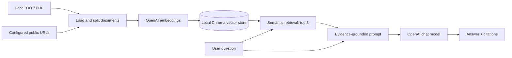

# Enterprise Knowledge Assistant

A Python command-line **Retrieval-Augmented Generation (RAG)** project that answers natural-language questions using evidence retrieved from local documents and selected public webpages. It uses **LangChain**, **OpenAI embeddings and chat models**, and a locally persisted **Chroma** vector database, with source citations in the generated responses.

> **Project scope:** This is a CLI demonstration, not a hosted web app or a production enterprise security solution. GitLab's public handbook is used as an example knowledge source. This project is **not affiliated with GitLab**.

## Key features

- **Document ingestion:** UTF-8 `.txt` and text-based `.pdf` files, plus explicitly configured public HTML pages.
- **Respectful webpage loading:** Checks `robots.txt`, spaces out requests, avoids automatic redirects, and does not crawl links or bypass logins.
- **Content processing:** Extracts article headings and text, then splits content into overlapping chunks (600 characters, 100-character overlap).
- **Semantic search:** Stores OpenAI-generated vector embeddings in a local, persistent Chroma collection and retrieves the top three relevant chunks.
- **Grounded answers:** Prompts the LLM to answer from retrieved evidence, with source labels and readable file/page or webpage links. It can abstain when evidence is insufficient.
- **Incremental indexing:** Updates changed source chunks while retaining unrelated indexed documents.
- **Testing:** Offline unit tests, optional live webpage extraction tests, and optional API-backed smoke checks.

## Architecture



## Tech stack

**Python 3.12**, LangChain, OpenAI API, ChromaDB, `pypdf`, `requests`, Beautiful Soup, `python-dotenv`, and Python `unittest`. Exact library versions are listed in [`requirements.txt`](requirements.txt).

## Repository structure

```text
enterprise-knowledge-assistant/
├── ingest.py                # Load, chunk and index local files / webpages
├── webpage_loader.py        # Extract selected public HTML pages
├── rag.py                   # Retrieve context and generate cited answers
├── live_check.py            # Optional API-backed RAG smoke checks
├── policy_urls.json         # Public webpage URLs to ingest
├── requirements.txt         # Pinned Python dependencies
├── .env.example             # Configuration template (no real secrets)
├── .gitignore
├── README.md
└── tests/
    ├── test_pipeline.py
    ├── test_webpages.py
    └── test_live_webpage.py
```

`data/documents/` can be created locally for your own `.txt` or text-based `.pdf` files. `data/chroma/` is generated during indexing and should **not** be committed. The source ZIP used to prepare this README does not include example documents or a `GUIDE.md` file.

## Getting started

### 1. Clone the repository

```bash
git clone https://github.com/KaushalChandrasekar/enterprise-knowledge-assistant.git
cd enterprise-knowledge-assistant
```

### 2. Create a virtual environment and install dependencies

**Windows PowerShell (Python 3.12):**

```powershell
py -3.12 -m venv .venv
.\.venv\Scripts\python.exe -m pip install --upgrade pip
.\.venv\Scripts\python.exe -m pip install -r requirements.txt
```

**macOS / Linux (Python 3.12):**

```bash
python3.12 -m venv .venv
./.venv/bin/python -m pip install --upgrade pip
./.venv/bin/python -m pip install -r requirements.txt
```

The commands below use `python` for readability. If you haven't activated the virtual environment, use `.\.venv\Scripts\python.exe` on Windows or `./.venv/bin/python` on macOS/Linux instead.

### 3. Set up environment variables

Copy the template and edit **only your local `.env`**:

```powershell
# Windows PowerShell
Copy-Item .env.example .env
```

```bash
# macOS / Linux
cp .env.example .env
```

The `.env.example` template should contain **placeholders**, never working credentials:

```dotenv
OPENAI_API_KEY=your_openai_api_key_here
OPENAI_CHAT_MODEL=gpt-4.1-mini
OPENAI_EMBEDDING_MODEL=text-embedding-3-small
LANGSMITH_TRACING=false
```

Replace the placeholder **in `.env` only**. An OpenAI API key is required for embedding/indexing and answer generation. API usage may incur charges. Extracted source text is sent to the embedding API, and retrieved excerpts are sent to the chat model; only index documents you are authorized to process this way.

> **Security warning:** An earlier project ZIP contained a real API key in both `.env` and `.env.example`. **Revoke/rotate that key before publishing.** Verify `.env.example` contains no secrets, and check `git status` / Git history before pushing. Never override GitHub secret-scanning protection to publish a live key. `.gitignore` alone does not erase secrets already committed in history.

### 4. Configure your sources

For **public webpage ingestion**, review [`policy_urls.json`](policy_urls.json) and keep only the URLs you want to process. It contains a JSON array of explicitly selected GitLab handbook pages; the loader does not follow links to other articles.

For **local files**, create a `data/documents/` folder and place your `.txt` or text-based `.pdf` documents inside. Scanned/image-only PDFs require OCR before this application can extract their text.

### 5. Preview webpage extraction (no API key needed)

```bash
python ingest.py --web --preview
```

This shows extracted chunks and metadata without generating embeddings or modifying Chroma. Web access is required, and individual websites can fail or change over time.

### 6. Build or update the index

**Configured webpages:**

```bash
python ingest.py --web
```

**Local documents:**

```bash
python ingest.py
```

**Both sources:**

```bash
python ingest.py --local --web
```

**A specific public URL:**

```bash
python ingest.py --urls "https://handbook.gitlab.com/handbook/finance/expenses/"
```

A normal re-index updates successful sources without wiping unrelated ones. Use `--rebuild` **only** when you deliberately want to replace the entire collection (for example, after changing the embedding model):

```bash
python ingest.py --local --web --rebuild
```

Note that `--rebuild` removes previously indexed sources not included in that run. If a requested webpage fails during a rebuild, the code cancels the rebuild. If indexing is interrupted, rerun ingestion before querying.

### 7. Ask questions

Inspect retrieved evidence without calling the chat model:

```bash
python rag.py "What does GitLab say about flexible PTO?" --retrieve-only
```

Generate a cited answer:

```bash
python rag.py "What does GitLab say about flexible PTO?"
python rag.py "What does GitLab's travel and expense policy say about approval?"
```

The CLI displays the answer, citation references, and retrieved evidence excerpts. Answers depend on the indexed sources and may be incomplete or inaccurate; verify important policies against their original pages.

## Testing

Run the offline test suite:

```bash
python -m unittest discover -s tests -p "test_*.py"
```

The repository also contains [`tests/test_live_webpage.py`](tests/test_live_webpage.py) for opt-in live webpage checks and [`live_check.py`](live_check.py) for API-backed RAG smoke checks. Live behavior and any required environment settings should be reviewed in those files before running them. API-backed checks may incur charges. Keyword-based smoke checks are **not** a formal measure of answer faithfulness or correctness.

## Limitations and responsible use

- This is a **command-line** app; there is no browser UI, deployed service, user authentication, or access-control layer.
- Retrieval uses top-three semantic matches; long documents and complex questions may need further investigation.
- Citation-label validation checks whether referenced labels exist, **not** whether every claim is factually supported.
- The vector index is stored locally and is not encrypted by this application. Avoid indexing confidential information unless your deployment and data handling controls are appropriate.
- Website availability, site structure, robots policies, and source contents may change.
- Public handbook content can have its own reuse and attribution requirements. Check [GitLab handbook usage and licensing information](https://handbook.gitlab.com/handbook/about/handbook-usage/) before redistributing handbook text or a derived index.

## GitHub safety checklist

Before pushing, confirm that `.env` and generated files are not staged:

```bash
git status --short
git diff --cached --name-only
```

Keep `.venv/`, `.env`, `__pycache__/`, and `data/chroma/` outside version control. **Do not put real credentials in `.env.example`, code, tests, commits, screenshots, or the README.** If a secret was already committed, rotate it and clean the affected Git history before pushing.

## Author

[Kaushal Chandrasekar](https://github.com/KaushalChandrasekar)

## License

No license has been assigned to this project's source code in the supplied archive. If you want others to reuse it, add an appropriate `LICENSE` file for code you own. Third-party content and libraries retain their own licenses.
