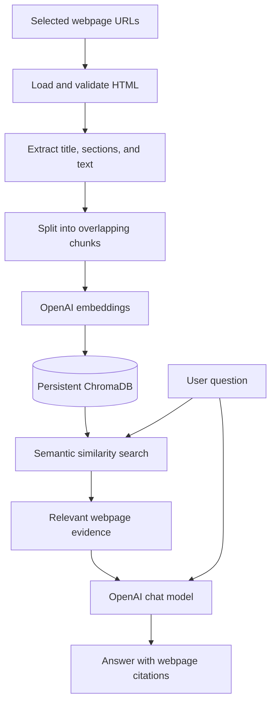

# Enterprise Knowledge Assistant — Webpage-Only RAG

A Python command-line **Retrieval-Augmented Generation (RAG)** application that answers questions using selected **public HTML webpages** as its knowledge base. It extracts webpage content, builds a searchable vector index with OpenAI embeddings and ChromaDB, and generates evidence-grounded answers with source citations.

**Scope:** Webpage ingestion only. This application does **not** ingest local PDF or TXT files, crawl an entire website, or provide a hosted web interface. The configured GitLab handbook pages are examples of public knowledge sources; this project is **not affiliated with GitLab**.

## Features

- **URL-driven ingestion:** Reads the list of webpages from `policy_urls.json` by default; optionally accepts URLs from the command line.
- **HTML content extraction:** Extracts readable text, headings, and sections while filtering navigation and other site clutter.
- **Responsible fetching:** Validates URLs, checks `robots.txt`, respects crawl delays, and rejects unsupported/non-HTML responses and automatic redirects.
- **Text chunking:** Splits webpage content into overlapping chunks (configured as 600 characters with 100-character overlap).
- **Semantic retrieval:** Creates OpenAI embeddings and stores them in a persistent local ChromaDB collection; the default query retrieves up to three relevant chunks.
- **Grounded answers:** Generates answers from retrieved evidence and includes citation labels linked to the original webpages.
- **Incremental updates:** Re-indexes changed webpage content while preserving other sources where possible; explicit rebuilds replace the collection.
- **Automated testing:** Uses mocked embedding/HTTP/LLM behavior and a temporary ChromaDB database for offline tests, plus an optional live webpage test.

## Architecture



## Technology stack

- **Language:** Python 3.12
- **RAG framework:** LangChain
- **Embeddings and answer generation:** OpenAI API
- **Vector database:** ChromaDB (`langchain-chroma`)
- **Webpage requests and parsing:** `requests`, Beautiful Soup
- **Configuration:** `python-dotenv`, JSON
- **Testing:** Python `unittest`

See [`requirements.txt`](requirements.txt) for the dependency versions in your project. The webpage-only requirements should **not** include `pypdf`.

## Project structure

```text
enterprise-knowledge-assistant/
├── ingest.py                  # Fetch, chunk, and index webpages
├── webpage_loader.py          # Validate URLs and extract HTML content
├── rag.py                     # Retrieve evidence and generate cited answers
├── live_check.py              # Optional API-backed RAG smoke checks
├── policy_urls.json           # Configured public webpage URLs
├── requirements.txt           # Python dependencies
├── .env.example               # Environment-variable template (placeholders only)
├── .gitignore                 # Ignore local secrets and generated files
├── README.md
└── tests/
    ├── test_pipeline.py      # Chunking, index persistence, retrieval, citations
    ├── test_webpages.py      # HTML extraction, fetching, and update safeguards
    └── test_live_webpage.py  # Opt-in live website check
```

`data/chroma/` is generated when you index content and should be excluded from Git. A local `.env` should also be excluded. **No `data/documents/` folder is required.**

## Setup

### 1. Clone and open the project

```bash
git clone https://github.com/KaushalChandrasekar/enterprise-knowledge-assistant.git
cd enterprise-knowledge-assistant
```

### 2. Create a virtual environment

**Windows PowerShell:**

```powershell
py -3.12 -m venv .venv
.\.venv\Scripts\Activate.ps1
python -m pip install -r requirements.txt
```

**macOS / Linux:**

```bash
python3.12 -m venv .venv
source .venv/bin/activate
python -m pip install -r requirements.txt
```

### 3. Configure environment variables

Create `.env` from `.env.example`:

**Windows PowerShell:**

```powershell
Copy-Item .env.example .env
```

**macOS / Linux:**

```bash
cp .env.example .env
```

Your `.env.example` must contain **only placeholder values**, for example:

```dotenv
OPENAI_API_KEY=your_openai_api_key_here
OPENAI_CHAT_MODEL=gpt-4.1-mini
OPENAI_EMBEDDING_MODEL=text-embedding-3-small
LANGSMITH_TRACING=false
```

Put your real key **only in your local `.env` file**. OpenAI API usage may incur charges. Webpage text is sent to the embedding model, and retrieved evidence is sent to the chat model.

> **Security:** A prior project version contained a real key in `.env.example`. Revoke that key if you have not already done so, replace it locally, and remove the secret from affected Git commits before pushing. Never use GitHub's secret-scanning bypass to publish a working key.

## Configure webpages

Edit [`policy_urls.json`](policy_urls.json) to select the public HTML pages you want to index. The file must contain a nonempty JSON list of URLs:

```json
[
  "https://handbook.gitlab.com/handbook/people-group/time-off-and-absence/time-off-types/",
  "https://handbook.gitlab.com/handbook/finance/expenses/"
]
```

These are example entries; your repository may include additional GitLab handbook pages. The application processes explicitly configured URLs only—it does **not** follow every link on a page. Websites may block requests, change layouts, or have restrictive `robots.txt` rules.

## Run the application

Run these commands from the repository root, with the virtual environment activated.

### Preview extracted webpage content

```bash
python ingest.py --preview
```

Uses `policy_urls.json` automatically and previews extracted content/chunk metadata **without calling the embeddings API** or changing ChromaDB. Internet access is still required to fetch webpages.

### Ingest the configured webpages

```bash
python ingest.py
```

Fetches URLs from `policy_urls.json`, generates embeddings, and updates the persistent index in `data/chroma/`.

### Ingest one or more specific URLs

```bash
python ingest.py --urls https://example.com/policy
```

The `--urls` argument **overrides** `policy_urls.json` for that run. Replace the example URL with a public HTML webpage you are permitted to access.

### Rebuild the index

```bash
python ingest.py --rebuild
```

Use a rebuild when you intentionally want the collection to contain only the currently configured webpages—for example, after removing local-file ingestion support. **Rebuilding replaces the current index**; verify that your configured URLs are correct and accessible first. If loading fails, the application should cancel the rebuild rather than discard indexed content.

### Ask a question

To inspect retrieved evidence without generating an answer:

```bash
python rag.py "What does GitLab say about flexible PTO?" --retrieve-only
```

To ask the RAG assistant:

```bash
python rag.py "What does GitLab say about flexible PTO?"
python rag.py "What does GitLab's travel and expense policy say about approvals?"
```

A successful answer should cite the retrieved webpage evidence using labels such as `[S1]`, with source URLs displayed below the answer. The assistant can return an insufficient-information response when the indexed pages do not support an answer. Verify important information against the original webpages.

## Run automated tests in VS Code

Open **Terminal → New Terminal** in VS Code and activate `.venv` before running the commands.

**Syntax check:**

```bash
python -m compileall -q ingest.py rag.py webpage_loader.py tests
```

**Pipeline tests:**

```bash
python -m unittest discover -s tests -p "test_pipeline.py" -v
```

**Webpage tests:**

```bash
python -m unittest discover -s tests -p "test_webpages.py" -v
```

**Full offline test suite:**

```bash
python -m unittest discover -s tests -v
```

The provided tests cover extraction, webpage metadata, chunk IDs, indexing, persistence, citations, and protections against failed updates. Mock embeddings and LLM responses avoid paid API calls for normal unit tests.

The live webpage extraction test in `tests/test_live_webpage.py` is **skipped by default**. To opt in on Windows PowerShell:

```powershell
$env:RUN_LIVE_WEB_TESTS = "1"
python -m unittest discover -s tests -p "test_live_webpage.py" -v
Remove-Item Env:RUN_LIVE_WEB_TESTS
```

The optional `live_check.py` performs API-backed checks against the indexed GitLab policy pages and may incur charges:

```bash
python live_check.py
```

### Windows ChromaDB cleanup note

When tests use `tempfile.TemporaryDirectory()` with ChromaDB, Windows may report `PermissionError: [WinError 32]` for a database file such as `data_level0.bin`. This is a **temporary database cleanup / file-lock issue**, not a failure to extract webpage text. Releasing ChromaDB references before directory removal is the preferred approach. In tests, `TemporaryDirectory(ignore_cleanup_errors=True)` can prevent cleanup errors from failing the suite, but it may leave temporary files behind.

In the latest test output shared during development, the pipeline tests passed independently, while four webpage tests encountered this cleanup issue. **Do not treat the full suite as passing until you rerun it and see `OK`** (with the expected optional skip).

## Limitations

- Accepts selected public **HTML webpages only**; PDF and TXT ingestion are intentionally out of scope.
- Does not crawl websites, authenticate to private portals, or provide a graphical UI.
- Cannot guarantee that every website can be fetched or parsed reliably.
- Citation validation checks reference labels; it does not independently prove every generated factual claim.
- Semantic retrieval may miss relevant context; answers should be checked against their cited sources.
- Local ChromaDB contents are not encrypted by this application. Avoid indexing confidential information without appropriate controls.
- Webpage owners' access restrictions, copyright, and usage terms still apply.

## GitHub publishing checklist

Before committing, confirm that your `.env.example` contains no real secrets, and verify your tracked files:

```bash
git status --short
git diff --cached --name-only
```

Keep `.env`, `.venv/`, `__pycache__/`, and `data/chroma/` out of the repository. Updating `.gitignore` does **not** remove a secret from Git history if it was committed earlier.

## Author

[Kaushal Chandrasekar](https://github.com/KaushalChandrasekar)

## License

No license was present in the original project ZIP. Add a `LICENSE` file if you want to explicitly grant others permission to reuse your code. Third-party libraries and webpage content are subject to their own terms.
