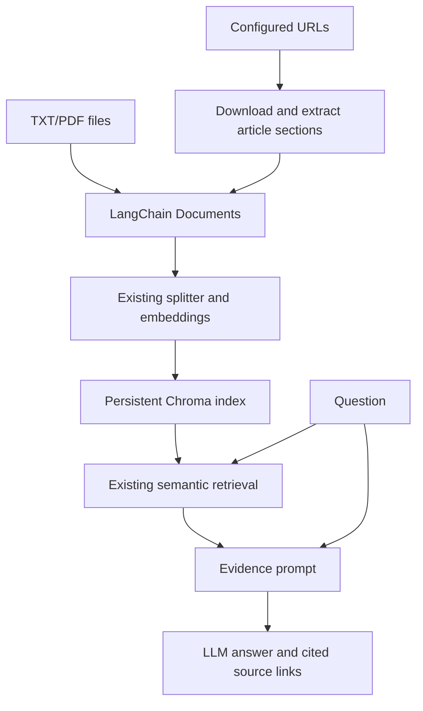

# Enterprise Knowledge Assistant

A Python-based Retrieval-Augmented Generation application that enables users to ask natural-language questions about organizational documents and publicly available company policies, with grounded answers and source citations.

## Overview

This project retains its original Python → LangChain → Chroma → semantic retrieval → LLM architecture. Webpages are an additional input format. It remains a small command-line application: no agents, hybrid search, reranking, cloud database, or new UI framework.

GitLab's public handbook is an example data source. This project is not affiliated with GitLab. Public availability does not remove licensing obligations: check the current handbook content license, attribution requirements, ShareAlike terms, and applicable notices before redistributing policy text or an index containing it. GitLab's handbook usage page describes its content license:
https://handbook.gitlab.com/handbook/about/handbook-usage/

This package contains source code, fictional local documents, and synthetic test HTML. It does not bundle downloaded GitLab policies, HTML snapshots, or an indexed database. The project code has no newly assigned license; choose an appropriate license for code you own before publishing it.

## Features

- UTF-8 TXT and text-based PDF ingestion; physical, one-based PDF page citations.
- Configurable, explicitly selected HTML URLs; no link crawling.
- Requests with identification, timeout, robots.txt checks, request spacing, and no automatic redirects.
- Main-content extraction using BeautifulSoup; cleanup of site navigation, footers, sidebars and cookie notices.
- Titles, section headings, paragraphs and list items retained as section-level Documents.
- Original recursive splitting: 600 characters, up to 100 characters of overlap.
- Original embedding models and local persistent cosine Chroma index.
- Stable source-specific chunk IDs, skipping unchanged chunks and removing obsolete ones.
- Top-three semantic retrieval, evidence-only prompting, abstention and citation-label validation.
- Clickable Markdown webpage sources and retained local TXT/PDF citation behavior.
- Offline mocked tests and a separate opt-in live extraction test.

## Technologies

Python 3.12 (64-bit), LangChain integration packages, Chroma, pypdf, python-dotenv, requests, BeautifulSoup and unittest. Existing LangChain/Chroma/model packages are retained at their original pinned versions. Only requests and BeautifulSoup are explicitly added to requirements.txt; requests was already installed transitively.

## Architecture



Only the input stage and source presentation change. The same Document objects feed the same splitter, embedding wrapper, vector store, retrieval, prompt assembly and generation functions.

## Project layout

```text
enterprise-knowledge-assistant/
  .env.example
  .gitignore
  requirements.txt
  policy_urls.json
  README.md
  GUIDE.md
  ingest.py
  webpage_loader.py
  rag.py
  live_check.py
  data/
    documents/
      leave_policy.txt
      expense_policy.txt
      it_manual.txt
    chroma/                  # generated locally; ignored by Git
  tests/
    test_pipeline.py
    test_webpages.py
    test_live_webpage.py
```

## Installation on Windows with VS Code

Install 64-bit Python 3.12 and VS Code with the Microsoft Python extension. Open the project folder and run these PowerShell commands:

```powershell
py -3.12 -m venv .venv
.\.venv\Scripts\python.exe -m pip install --upgrade pip
.\.venv\Scripts\python.exe -m pip install -r requirements.txt
.\.venv\Scripts\python.exe -m pip check
```

Choose .venv\Scripts\python.exe through VS Code's Python: Select Interpreter command. These commands do not require activating a PowerShell script.

To update an existing environment, retain your .env and data/chroma directory and run only the install and pip check commands. When copying the updated project over your existing one, remove the superseded lesson and test files with their old numbered-stage names; otherwise test discovery can run obsolete assertions. The supplied ZIP contains only the current names.

## Environment variables

For a new installation only:

```powershell
Copy-Item .env.example .env
```

Open .env and supply your own OPENAI_API_KEY. Keep the initial OPENAI_CHAT_MODEL=gpt-4.1-mini, OPENAI_EMBEDDING_MODEL=text-embedding-3-small and LANGSMITH_TRACING=false settings. No API key is required for HTML preview or ordinary tests. Indexing new/changed chunks and answering questions use the configured API and may incur charges. Document text is sent for embedding; retrieved context is sent for generation. Never commit .env or data/chroma. Do not overwrite an existing .env with the example file.

## Configure webpage URLs

Edit policy_urls.json. It is a JSON array, not Python code:

```json
[
  "https://handbook.gitlab.com/handbook/people-group/time-off-and-absence/time-off-types/",
  "https://handbook.gitlab.com/handbook/finance/expenses/",
  "https://handbook.gitlab.com/handbook/people-policies/"
]
```

Verified on 12 October 2026: the three configured pages returned HTTP 200, with titles Time Off Types, Global Travel and Expense Policy, and People Policies. The old /handbook/paid-time-off/ URL returned HTTP 404 in a direct Requests check; an earlier web fetch encountered an authentication redirect. It is not a usable public source in these checks. The configured Time Off Types page contains the current accessible Flexible PTO documentation.

The loader ingests only these URLs. People Policies contains references to other policy pages; those destination pages are NOT automatically downloaded. Add a particular public destination URL explicitly if you need its full policy text.

The homepage origin's robots.txt is fetched once per ingestion run. Currently GitLab's response contains User-agent: * without a disallow rule. The code checks it on each run, waits at least one second between requests, and honors longer crawl-delay/request-rate values. If robots.txt cannot be verified, the source is skipped. A missing robots.txt (404) is treated as no published robot restrictions. A redirect, sign-in page, access denial, or HTTP failure is never bypassed. Configure a current public destination rather than enabling redirect or authentication workarounds.

## Preview extraction without an API key

```powershell
.\.venv\Scripts\python.exe ingest.py --web --preview
```

This downloads the configured pages, extracts content and reports source metadata and chunk counts. It does not create embeddings or modify Chroma. Inspect extraction before paying for indexing.

To preview one explicit URL instead of policy_urls.json:

```powershell
.\.venv\Scripts\python.exe ingest.py --urls "https://handbook.gitlab.com/handbook/finance/expenses/" --preview
```

## Ingest documents

Index or refresh configured webpages, keeping unrelated indexed documents:

```powershell
.\.venv\Scripts\python.exe ingest.py --web
```

Load one or multiple explicit URLs instead of the config:

```powershell
.\.venv\Scripts\python.exe ingest.py --urls "https://handbook.gitlab.com/handbook/finance/expenses/" "https://handbook.gitlab.com/handbook/people-policies/"
```

Original local-only command remains supported:

```powershell
.\.venv\Scripts\python.exe ingest.py
```

Load both input types:

```powershell
.\.venv\Scripts\python.exe ingest.py --local --web
```

Use this ONLY when you intend to replace the entire project collection, including unrelated documents:

```powershell
.\.venv\Scripts\python.exe ingest.py --local --web --rebuild
```

A rebuild is cancelled if a requested URL fails. Normal refresh updates successful sources, retains existing copies of failed sources, reports errors and exits with a nonzero status. A retained failed source can be stale; retry successfully before relying on its policy. Removing a URL from the configuration does not remove an already indexed copy. An explicit full rebuild can remove omitted sources; no complicated version registry is introduced.

Stable IDs hash source, per-source chunk position, content and metadata. The same source/content/settings generate the same IDs even when unrelated documents are added. On refresh, unchanged IDs skip embedding; new IDs are added first; obsolete IDs for that source are deleted afterward. Unrelated sources are untouched. Original sequential chunk IDs are replaced automatically when their source is next ingested.

These writes are not a multi-source transaction. The manifest is marked not ready before indexing; an interrupted update blocks querying until ingestion succeeds again. The embedding model is retained in that manifest to prevent accidental mixed embedding spaces. Do not run indexing and querying concurrently. Changing the embedding model requires an explicit rebuild with ALL desired sources.

## Ask questions

Inspect evidence first:

```powershell
.\.venv\Scripts\python.exe rag.py "What does GitLab say about coordinating flexible PTO?" --retrieve-only
```

Generate an answer:

```powershell
.\.venv\Scripts\python.exe rag.py "What does GitLab say about coordinating flexible PTO?"
.\.venv\Scripts\python.exe rag.py "What responsibilities do GitLab managers have under the travel and expense policy?"
.\.venv\Scripts\python.exe rag.py "Which entity-specific people policies are listed for India?"
```

Use focused questions. Three chunks may not cover every exception in a long handbook. The prompt distinguishes GitLab from the bundled fictional Northstar documents, but that is guidance, not a formal company access or scope filter.

Illustrative output, not a captured LLM result:

```text
Coordinate planned PTO with your manager and arrange coverage. [S1]

Sources:
- [S1] Time Off Types — [https://handbook.gitlab.com/handbook/people-group/time-off-and-absence/time-off-types/](https://handbook.gitlab.com/handbook/people-group/time-off-and-absence/time-off-types/)
```

The CLI also prints cited excerpts for inspection. Markdown links are clickable in Markdown viewers; VS Code's terminal can generally open the displayed raw URL. Only source labels present in the generated answer are included, and repeated URLs are grouped into one source entry. Webpages have no invented page numbers. Local PDF citations still display physical PDF pages.

If the available evidence cannot answer a question, the instructed response is:

```text
I could not find this information in the provided documents.
```

Valid citation labels do not prove factual support or complete coverage of every sentence. The model can still ignore instructions or confuse sources. Verify important statements against the cited original policy. No retrieval threshold or independent factual verifier is added.

## Automated tests

Free, offline tests with mocked HTTP, fake models and real temporary Chroma storage:

```powershell
.\.venv\Scripts\python.exe -m unittest discover -s tests -v
```

The live extraction test is skipped unless enabled. Ordinary tests never call GitLab, embeddings, or an LLM API.

Run the opt-in live webpage extraction test (network access, no paid model calls):

```powershell
$env:RUN_LIVE_WEB_TESTS="1"
.\.venv\Scripts\python.exe -m unittest discover -s tests -p test_live_webpage.py -v
Remove-Item Env:RUN_LIVE_WEB_TESTS
```

The existing paid live_check.py still checks the fictional local sample documents. Load those samples using ingest.py before using it:

```powershell
.\.venv\Scripts\python.exe live_check.py
```

Verification performed: 28 offline tests passed, one live test was skipped in the default suite, the opt-in live extraction test passed separately, and extraction preview succeeded for all three configured GitLab URLs. pip check reported no broken requirements. No paid live embedding/generation calls were made. Windows execution must still be verified on your computer.

## Troubleshooting

| Problem | Action |
|---|---|
| Missing Python package | Install requirements using the same virtual environment interpreter |
| Missing key or HTTP 401 from model API | Check .env and API key/project access |
| API quota error | Check API billing and limits |
| URL timeout, 403, redirect or robots failure | Source is skipped; check the public URL/network and retry without bypassing restrictions |
| No article content | Inspect public HTML with --preview; dynamic-only and login pages are unsupported |
| Index marked interrupted | Repeat the intended ingestion after fixing the failure |
| Embedding model mismatch | Rebuild with every source you wish to retain |
| Answer unsupported or incomplete | Inspect --retrieve-only and check whether the necessary page/section was explicitly indexed |
| Fictional and real policies confused | Name the company in the question; consider a GitLab-only full rebuild if you intentionally want to remove sample documents |

## Limitations

- Static public HTML only; no JavaScript browser rendering, authenticated pages or access bypass.
- A structural extraction fallback can still retain unrelated text on unfamiliar websites.
- Simple text/list/table extraction does not fully reconstruct complex tables or images.
- The local CLI URL list is trusted configuration; this is not a secure public URL-submission service.
- Top-three semantic retrieval can omit important exceptions or country-specific context.
- Data stays at the last successful ingestion; there is no scheduler, crawler or version history.
- No production authentication/access controls, agents or hybrid retrieval.
- Prompt-based abstention and citation-label checks reduce mistakes but cannot guarantee truth.
- Source-by-source updates are not atomic across the whole collection; interrupted writes require recovery.
- Current public policy and applicable licensing terms must be checked before relying on or redistributing content.

GUIDE.md includes the complete contents of every project file plus a beginner-friendly walkthrough of each significant change.
