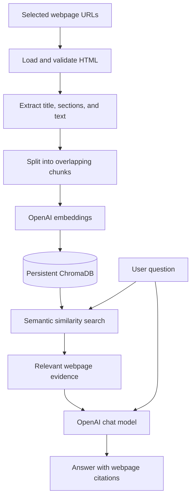

# Enterprise Knowledge Assistant

A command-line RAG (retrieval-augmented generation) tool that answers questions from a handful of public webpages. It pulls the text out of the pages you choose, indexes it in a local ChromaDB store using OpenAI embeddings, and answers questions with citations pointing back to the original pages.

I used a few public GitLab handbook pages as the sample knowledge base. This project isn't affiliated with GitLab.

Scope: it only handles HTML webpages you list explicitly. It doesn't ingest local PDF/TXT files, crawl whole sites, or ship with a web UI.

## What it does

- Reads URLs from `policy_urls.json` by default, or from the command line with `--urls`.
- Extracts the readable text, headings and sections from each page and skips navigation and other clutter.
- Fetches politely: validates URLs, checks `robots.txt`, respects crawl delays, and rejects non-HTML responses and automatic redirects.
- Splits text into overlapping chunks (600 characters, 100 overlap).
- Stores embeddings in a persistent local ChromaDB collection. A query retrieves the top three chunks by default.
- Generates answers from the retrieved text only, with citation labels like `[S1]` that map back to the source URLs.
- Re-indexes only pages whose content changed. A full rebuild replaces the whole collection.
- Tests run offline with mocked HTTP, embeddings and LLM calls, plus a temporary ChromaDB directory. There's also an opt-in live test.

## How it works



## Tech stack

- Python 3.12
- LangChain
- OpenAI API (embeddings and chat)
- ChromaDB via `langchain-chroma`
- `requests` and Beautiful Soup for fetching and parsing
- `python-dotenv` and JSON for configuration
- `unittest` for tests

Dependencies are listed in `requirements.txt`.

## Project structure

```text
enterprise-knowledge-assistant/
├── ingest.py                  # Fetch, chunk and index webpages
├── webpage_loader.py          # URL validation and HTML extraction
├── rag.py                     # Retrieval and cited answer generation
├── live_check.py              # Optional API-backed smoke checks
├── policy_urls.json           # Configured webpage URLs
├── requirements.txt
├── .env.example               # Placeholder environment variables
├── .gitignore
├── README.md
└── tests/
    ├── test_pipeline.py       # Chunking, persistence, retrieval, citations
    ├── test_webpages.py       # HTML extraction, fetching, update safeguards
    └── test_live_webpage.py   # Opt-in live website check
```

`data/chroma/` is created when you index content. It's git-ignored, along with your local `.env`.

## Setup

### 1. Clone the repo

```bash
git clone https://github.com/KaushalChandrasekar/enterprise-knowledge-assistant.git
cd enterprise-knowledge-assistant
```

### 2. Create a virtual environment and install dependencies

Windows PowerShell:

```powershell
py -3.12 -m venv .venv
.\.venv\Scripts\Activate.ps1
python -m pip install -r requirements.txt
```

macOS / Linux:

```bash
python3.12 -m venv .venv
source .venv/bin/activate
python -m pip install -r requirements.txt
```

### 3. Add your API key

Copy the example env file:

Windows PowerShell:

```powershell
Copy-Item .env.example .env
```

macOS / Linux:

```bash
cp .env.example .env
```

Then open `.env` and fill in your key. The defaults look like this:

```dotenv
OPENAI_API_KEY=your_openai_api_key_here
OPENAI_CHAT_MODEL=gpt-4.1-mini
OPENAI_EMBEDDING_MODEL=text-embedding-3-small
LANGSMITH_TRACING=false
```

Keep your real key in `.env` only and never commit it. OpenAI usage costs money: page text is sent to the embedding model, and retrieved chunks are sent to the chat model.

## Choosing webpages

`policy_urls.json` holds the pages to index. It must be a non-empty JSON list of URLs, for example:

```json
[
  "https://handbook.gitlab.com/handbook/people-group/time-off-and-absence/time-off-types/",
  "https://handbook.gitlab.com/handbook/finance/expenses/"
]
```

Only the URLs you list are processed. The app never follows links on a page. Some sites block automated requests, change their layout, or have restrictive `robots.txt` rules, so not every page will work.

## Usage

Run everything from the repo root with the virtual environment active.

### Preview extracted content

```bash
python ingest.py --preview
```

Shows the extracted text and chunk metadata for the configured URLs. It doesn't call the embeddings API or touch ChromaDB, but it does need internet access to fetch the pages.

### Index the configured pages

```bash
python ingest.py
```

Fetches the URLs, creates embeddings and updates the index in `data/chroma/`.

### Index specific URLs

```bash
python ingest.py --urls https://example.com/policy
```

`--urls` replaces `policy_urls.json` for that run. Only use public pages you're allowed to access.

### Rebuild the index

```bash
python ingest.py --rebuild
```

This replaces the collection so it contains only the currently configured pages. Check that your URLs are correct and reachable first. If loading fails, the rebuild is cancelled and the existing index is left alone.

### Ask a question

To see the retrieved evidence without generating an answer:

```bash
python rag.py "What does GitLab say about flexible PTO?" --retrieve-only
```

To get an answer:

```bash
python rag.py "What does GitLab say about flexible PTO?"
python rag.py "What does GitLab's travel and expense policy say about approvals?"
```

Answers cite their evidence with labels like `[S1]`, and the matching source URLs are printed underneath. If the indexed pages don't support an answer, the assistant says so instead of guessing. For anything important, check the original page.

## Tests

Activate `.venv` first, then:

```bash
# Syntax check
python -m compileall -q ingest.py rag.py webpage_loader.py tests

# Pipeline tests
python -m unittest discover -s tests -p "test_pipeline.py" -v

# Webpage tests
python -m unittest discover -s tests -p "test_webpages.py" -v

# Full offline suite
python -m unittest discover -s tests -v
```

The tests cover extraction, webpage metadata, chunk IDs, indexing, persistence, citations, and safeguards against failed updates. Embeddings and LLM responses are mocked, so they don't cost anything to run.

The live webpage test in `tests/test_live_webpage.py` is skipped by default. To run it (PowerShell):

```powershell
$env:RUN_LIVE_WEB_TESTS = "1"
python -m unittest discover -s tests -p "test_live_webpage.py" -v
Remove-Item Env:RUN_LIVE_WEB_TESTS
```

`live_check.py` runs a few real queries against the indexed GitLab pages. It calls the OpenAI API, so it may cost a little:

```bash
python live_check.py
```

### Windows note: ChromaDB cleanup errors

On Windows, tests that use `tempfile.TemporaryDirectory()` with ChromaDB can fail with `PermissionError: [WinError 32]` on a file like `data_level0.bin`. That's a file lock during temp-directory cleanup, not an extraction problem. The cleanest fix is to release the Chroma references before the directory is removed. As a workaround, `TemporaryDirectory(ignore_cleanup_errors=True)` stops the error from failing the suite, though it can leave temp files behind.

## Limitations

- HTML webpages only. PDF and TXT ingestion is deliberately out of scope.
- No site crawling, no login-protected pages, no graphical UI.
- Some sites can't be fetched or parsed reliably.
- Citation checking only validates the reference labels. It doesn't prove that every claim in an answer is supported.
- Semantic search can miss relevant passages, so check answers against the cited sources.
- ChromaDB data is stored unencrypted. Don't index confidential content without proper controls.
- The copyright and usage terms of the sites you index still apply.

## Author

[Kaushal Chandrasekar](https://github.com/KaushalChandrasekar)

## License

No license has been added yet. Until one is, the default is all rights reserved. Third-party libraries and webpage content are covered by their own terms.
